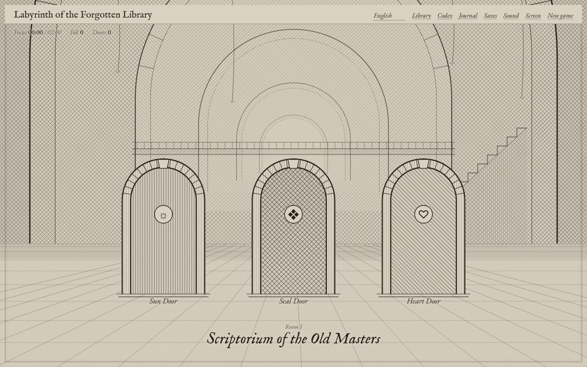
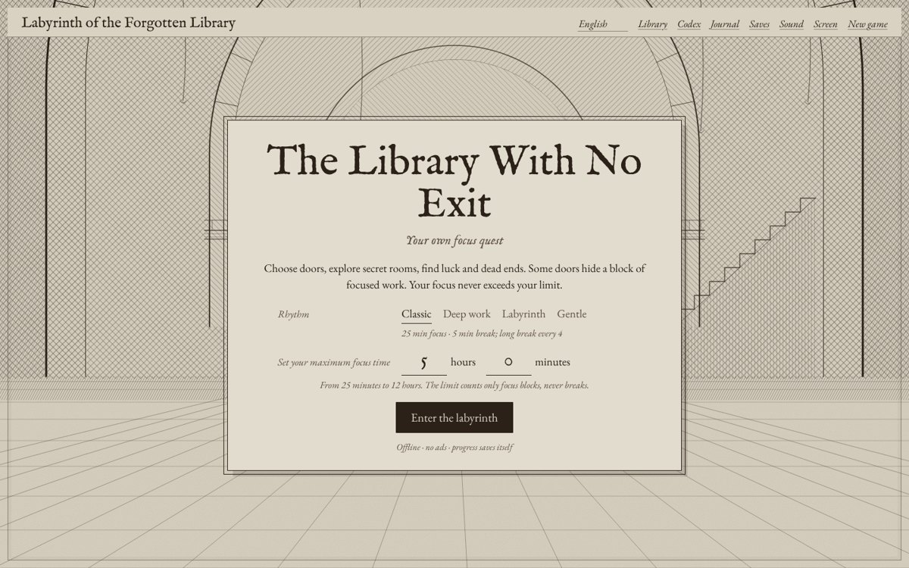
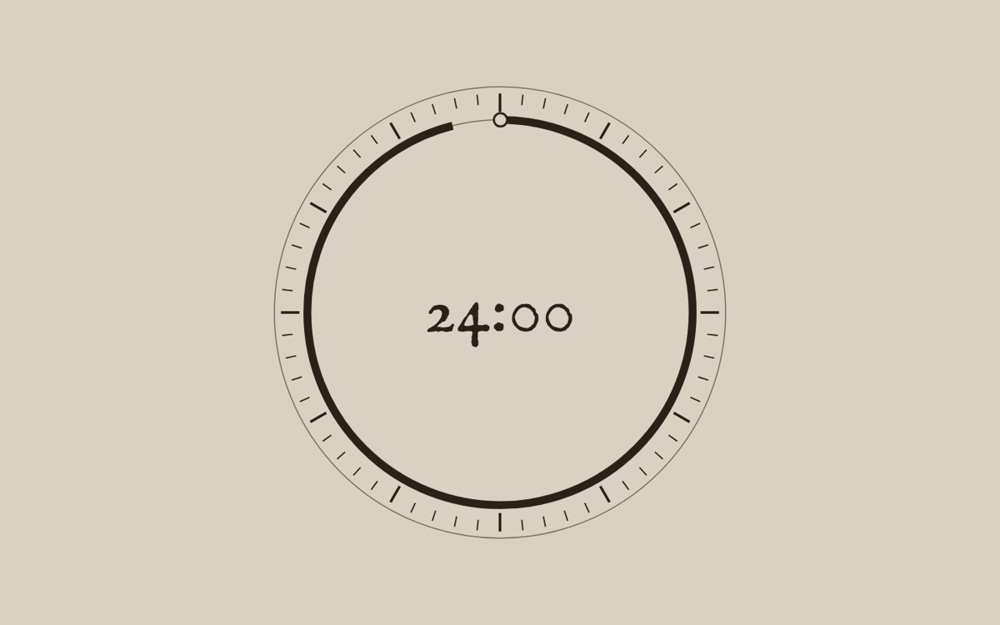
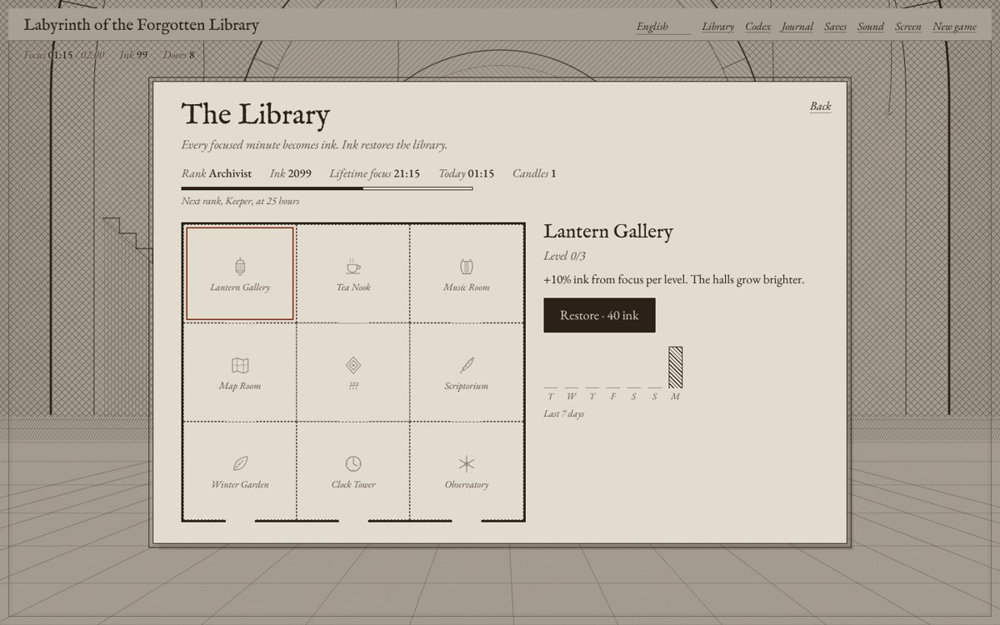
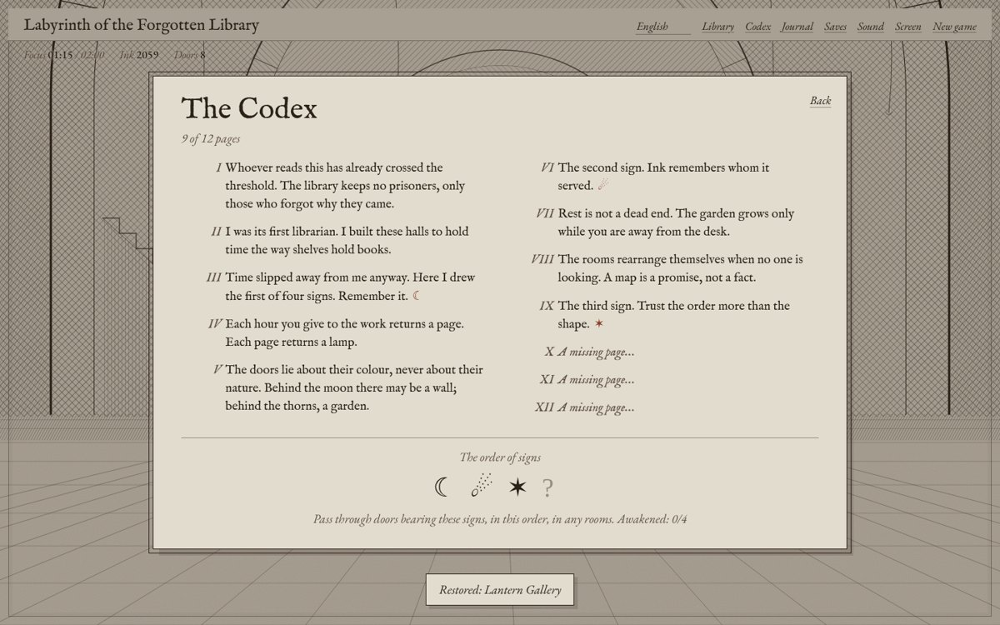

# Labyrinth of the Forgotten Library

A focus timer disguised as a labyrinth. You walk through an engraved library, room after room, choosing one of three doors. Behind a door you may find a block of focused work, a lucky passage, a relic, a lost page, a secret corridor or a dead end. You never know which. The game keeps you studying in Pomodoro rhythm and never lets your focus time exceed the limit you set.

**[Play it here](https://andrea212023.github.io/forgotten-library/)**



## How it works

1. Choose a rhythm (Classic 25/5, Deep work 50/10, Labyrinth with random 15 to 60 minute blocks, or Gentle 15 to 20/5) and your maximum focus time.
2. Pick a door. If a focus block waits behind it, the dial starts and a signal sounds at the end.
3. Take the break the game offers, or skip it. Every fourth block (third in Deep work) earns a long break.
4. Somewhere a door leads out. It only appears once you have worked enough.

Every focused minute becomes ink. Ink restores the library across sessions: eight wings, three levels each, opening as your lifetime focus grows. Twelve lost pages tell the story of the first librarian and hide four signs. Walk through doors bearing those signs, in order, and something opens.

| | |
|---|---|
|  |  |
|  |  |

## Languages

English, Українська, Русский, Français, Deutsch, Español, Italiano, Português, Polski, Nederlands, Türkçe, 日本語, 中文, 한국어, العربية (right to left), हिन्दी. The game follows your browser's language and has a switcher in the top bar.

## Privacy

No accounts, no analytics, no ads. Progress is stored only in your browser (localStorage). You can download a save file or copy a save code to move it to another device.

## Running and editing

The whole game is one file, `index.html`. Open it in a browser, or publish the repository with GitHub Pages (Settings, Pages, deploy from the `main` branch).

To edit, change the files in `src/` and rebuild:

```
python3 build.py
```

- `src/app.js`: game logic and drawing
- `src/style.css`: the etching style
- `src/i18n/*.js`: one file per language, all with the same keys as `en.js`

Fonts (IM Fell English, EB Garamond, Old Standard TT, Amiri, Tiro Devanagari Hindi) load from Google Fonts; without a connection the game falls back to system serif fonts and still works.

## Credits

Game concept, design and original version by Andrianna-Mariia Kis. Developed with AI assistance (Claude, by Anthropic).

Visual style after the etchings of Giovanni Battista Piranesi, *Carceri d'invenzione* (first published around 1750, reworked in 1761).

## Licence

MIT, see [LICENSE](LICENSE).
